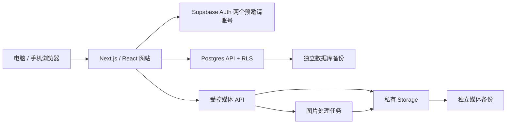

# 两个人的旅行记忆：技术方案与上线路线

方案日期：2026-11-10（资料核验于 2026-11-09 至 10 日）。本文区分本次本地 Demo、下一阶段可长期使用的私密 MVP，以及照片规模增长后的扩展。服务价格与配额按当日可查官方资料整理，最终以开通时账单和地区可用性为准。工期为开发估算，不包含账号开通、域名审核等等待。

## 1. 推荐结论

第一版做成两人共同维护的私人旅行档案：世界地图发现足迹，国家地图查看城市，每次旅行保存日期、路线、短描述、日记和相册；同一份资料可切换地图、手记、照片墙、时间线。手机端能轻松补记和批量上传，电脑端适合整理与回顾。

**推荐正式 MVP：稳定版 Next.js / React / TypeScript + Supabase Auth / Postgres / 私有 Storage，先用一个存储服务。** 前端先在托管平台免费额度内试运行；录入大量真实照片前选择付费数据库方案并完成独立备份。两个人的小应用不需要微服务、独立搜索集群或提前引入多云存储。先把隐私、上传体验和导出恢复做完整。

本次 Demo 使用项目 Sites starter 的 Vinext / React 19 / TypeScript，便于本地展示；生产阶段先核验认证回调、Cookie、服务端接口、图片处理与托管适配，再决定沿用 Cloudflare Workers 路径，或切换稳定 Next.js 部署到 Vercel。当前仓库锁定的 Vinext 包含 beta 标识，不能把本地 build 成功视为生产运行验证。Cloudflare 当前官方文档已提供 Vinext 部署路线，但是否适合本项目仍需上述实测。[Cloudflare Next.js 部署文档](https://developers.cloudflare.com/workers/framework-guides/web-apps/nextjs/)

**后续照片量很大时，才把对象存储迁移到 Cloudflare R2。** Supabase 继续负责登录和数据库，应用保留统一的媒体访问层；迁移需要新增签名、上传、处理任务和删除一致性逻辑。R2 的低存储费不等于整套网站每月只花几美元。

## 2. 本次 Demo 的边界

本地 Demo 的目的是验证审美、地图交互、记录结构和手机布局。地图使用 d3-geo + topojson + world-atlas 的静态国家边界，不依赖第三方在线瓦片；浏览器 IndexedDB 保存本机新增旅行及照片。最终交付 README 应记录实际实现和验证结果，本文中的生产路线不代表已经接入。

- 示例旅行和图片仅用于展示，不代表你们真实去过的地方。
- 浏览器中的修改只保留在当前浏览器、当前站点来源。更换端口、域名、设备或清除站点数据，可能无法继续读取；隐身模式、磁盘回收也可能使数据消失。
- Demo 没有完成真正的双人认证、云端权限隔离、自动备份和跨设备同步，不能作为唯一照片库。
- 当前 GitHub 仓库为公开仓库：代码可以提交，真实照片、情侣日记、EXIF、数据库导出、账号凭据不能进入 Git 历史。后续建议把仓库改为私有；即便仓库私有，真实媒体仍存私有对象存储。
- 本阶段不购买域名，不替用户注册账号，不创建付费云资源；这些不影响先看本地网站。

## 3. 产品结构与视觉方向

### 四个主要入口

| 页面     | 主要内容                              | 交互                                             |
| -------- | ------------------------------------- | ------------------------------------------------ |
| 足迹地图 | 已去国家 / 地区高亮、城市点、旅行统计 | 国家点击下钻；城市点打开相关旅行；搜索与年份筛选 |
| 旅行手记 | 封面卡片、日期、路线、短描述          | 打开完整日记与相册；新增、编辑、归档             |
| 照片墙   | 按时间与旅行筛选的照片                | 瀑布流或规则网格；灯箱；前后切换；回到所属旅行   |
| 时光线   | 按年分组的旅行节点                    | 同一旅行展示封面、路线与日期，不复制业务数据     |

首页像一本精装旅行杂志：暖白纸感、墨色正文、克制的赭红或深绿色点缀，足量留白、真实摄影为主。标题可以衬线，导航和编辑界面用易读无衬线；字体本地托管或系统回退，避免首次打开被外部字体网络阻塞。地图低对比底色，足迹使用明确颜色，文字统计同时表达状态，不能仅凭颜色辨认。

桌面以地图为主视觉，右侧或下方配旅行摘要；手机使用顶部简洁标题、底部四项导航，旅行详情使用全屏页或抽屉。编辑器遵循“基本信息 → 地点路线 → 内容与照片”，支持保存草稿。触摸目标至少 44px，表单有显式 label，弹窗可键盘关闭，动效尊重减少动画偏好。

### 响应式与性能目标

- 设计覆盖 360px 手机、390–430px 手机、768px 平板、1280–1440px 桌面；横竖屏均可操作。
- 手机地图默认适合浏览的高度；滚动页面时不抢占所有触摸，提供明确缩放 / 返回世界按钮。
- 小国和密集城市提供列表入口与点聚合，避免仅靠手指精确点中边界。
- 图片按实际屏幕尺寸加载，首屏只优先加载一张主视觉；相册分页，缩略图懒加载，不一次下载全部原图。
- 正式验收以实机 / 限速测量为准，目标 LCP ≤ 2.5s、CLS ≤ 0.1、INP ≤ 200ms；重点看登录后地图首屏和大相册，不把本地开发服务器速度当成线上结果。

## 4. 地图、地点和“解锁”规则

### 地图分层

世界层显示国家 / 地区边界，点击某个国家进入该国适配边界的国家地图，并展示已去城市点位、城市名称及旅行入口。**第一版“城市解锁”使用点位与已去城市列表**，不承诺全球所有城市行政边界；真正填充城市行政区多边形需要逐国数据集、层级归一和授权核验，应作为后续功能。省 / 州级填色也单独排期。

仅靠低精度世界边界放大，在狭小国家、群岛和复杂海岸会缺乏细节；Demo 可以如此验证交互，生产按需懒加载更精细、经核验的国家数据。地图路线用城市中心连线，是“旅行顺序示意”，不宣称还原飞机航线、铁路或 GPS 轨迹。跨日期变更线的旅行需要测试连线分段。

Natural Earth 数据可用于原型和产品设计参考，其官方将地图数据置于公有领域；版权允许使用与正式展示符合当地地图规则是两项不同的核验。[Natural Earth 使用条款](https://www.naturalearthdata.com/about/terms-of-use/)

### 标准地点字典

- `country_code` 使用 ISO 3166-1 alpha-2 标识国家 / 地区，例如 `CN`、`JP`，另保存 alpha-3 / numeric 到地图图形 ID 的显式映射；名称只是展示值，不作为主键。
- 不直接把地图数据集所有多边形数量当作“全世界国家总数”。显示“已留下足迹的国家 / 地区 X”，若增加百分比，先明确并版本化分母清单，说明如何处理地区和特殊代码。
- 城市使用内部 UUID + `source` / `source_id`（如 GeoNames ID）作为稳定标识，记录名称、多语言别名、国家、一级行政区、城市中心经纬度和字典版本。中国行政区代码可作为附加字段，不能假设全球所有城市都有同一种行政代码。
- 同名城市通过国家与行政区区分；城市改名保留原 ID 和别名；暂时找不到的地点支持人工创建，标为待核验，之后通过 merge 映射归并，不靠中文字符串去重。
- 首版导入常用城市 + 两人已去地点，搜索本地 / 数据库字典；后续接外部地理编码服务时，核验授权、限额、缓存条款、地区可用性。可下载 GeoNames 城市资料并按其署名许可保留来源声明。[GeoNames 官方数据说明](https://www.geonames.org/export)

统一保存 WGS84 十进制度坐标，GeoJSON / 地图组件传 `[longitude, latitude]`，数据库拆成 `longitude` 和 `latitude` 避免混淆；约束经度 -180…180、纬度 -90…90。投影只在绘制时进行，不能把屏幕坐标当经纬度。若后续接入使用不同坐标体系的地图 SDK，在适配层转换并记录来源，避免重复转换造成偏移。[GeoJSON 坐标规范 RFC 7946](https://www.rfc-editor.org/rfc/rfc7946)

### 计数与状态

1. 一次旅行可以跨多个国家、多个城市，同一城市也可以在路线中多次出现，`trip_stops` 记录顺序及可选起止日期。
2. 旅行状态分为草稿、计划、已完成；归档使用独立 `archived_at` 字段。只有双方共同空间中“已完成且未删除”的有效停留计入足迹。归档仅收起记录，仍计入足迹，删除 / 取消完成才撤销。
3. 城市至少存在一条 `visit_type = stayed / visited` 的完成旅行停留，才解锁；纯机场转机、途经默认不计入，用户可以显式修改。
4. 国家 / 地区由上述有效城市停留，或人工确认的国家级访问推导。重复旅行只增加旅行次数，国家和城市解锁数量按稳定 ID `distinct` 去重。
5. 删除旅行后重新计算；一座城市仍有其他完成旅行则继续解锁。照片 EXIF 推断地点只提供候选，不自动增加足迹。
6. 先使用 SQL view / 查询聚合，数据量达到瓶颈再做物化统计；四种视图都读取同一旅行数据，避免数字不一致。

## 5. 正式架构

前端保留 `TripRepository`、`MediaRepository` 接口，Demo 使用浏览器实现，正式版换成 Supabase 实现。尽量复用 UI 和验证规则，不让 IndexedDB 格式决定云端数据表。地图和媒体库按页面拆包。旅行详情使用稳定路由 `/trips/:id`，国家页 `/atlas/:countryCode`；筛选条件放在 URL，手机返回时保留浏览状态。

数据库访问以用户身份执行 RLS；需要系统权限的邀请、备份、处理任务仅运行于服务端。图片处理使用适合 HEIC 解码和内存需求的 Node / 容器任务或经验证的托管图像服务；不要假定 Edge / Worker 环境能直接运行所有 native 图像库。异步任务可先用数据库任务表 + 幂等 worker，规模增长再引入独立队列。

### 建议数据模型

| 表                | 关键字段与约束                                                                                                                                                                |
| ----------------- | ----------------------------------------------------------------------------------------------------------------------------------------------------------------------------- |
| `spaces`          | `id`, `title`, `created_at`；两人的共享空间                                                                                                                                   |
| `space_members`   | `(space_id, user_id)` 唯一；`role` 为 owner / editor；成员上限由管理函数执行                                                                                                  |
| `countries`       | `code` PK, `name_zh`, `name_en`, `map_id`, `dataset_version`                                                                                                                  |
| `places`          | `id`, `country_code`, `admin1_code`, `name`, `aliases`, `longitude`, `latitude`, `source`, `source_id`；来源 ID 唯一                                                          |
| `trips`           | `id`, `space_id`, `title`, `summary`, `start_date`, `end_date`, `status`, `cover_photo_id`, `version`, `created_by`, `updated_by`, `archived_at`, `deleted_at`                |
| `trip_stops`      | `id`, `trip_id`, `space_id`, `place_id?`, `country_code`, `order_index`, `arrival_date`, `departure_date`, `visit_type`；允许只明确国家的访问，城市已知时必填 place           |
| `journal_entries` | `id`, `trip_id`, `space_id`, `entry_date`, `body_json` / `body_markdown`, `version`, `author_id`                                                                              |
| `photos`          | `id`, `trip_id`, `space_id`, `stop_id?`, `uploader_id`, `caption`, `taken_at?`, `taken_timezone?`, `sort_order`, `sha256`, `bytes`, `width`, `height`, `status`, `deleted_at` |
| `photo_assets`    | `id`, `photo_id`, `space_id`, `variant`（original / preview / thumb）, `provider`, `bucket`, `object_key`, `mime`, `bytes`, `checksum`                                        |
| `upload_jobs`     | `id`, `space_id`, `photo_id`, `idempotency_key`, `state`, `retry_count`, `error_code`                                                                                         |
| `activity_log`    | 谁在何时更新 / 删除哪条记录；不存正文和照片 URL token                                                                                                                         |

旅行日历日期使用 `date`，避免按 UTC 转换后日期倒退；系统创建 / 更新时间使用 `timestamptz`。照片拍摄时间可能没有时区，保留原始时间及“时区未知”标志，不能静默假定为北京时间。`end_date >= start_date`；路线日期如填写，应在旅行日期内。跨表以组合外键 / 受控事务确保照片、日记、停留属于同一空间和旅行，防止仅伪造 `space_id` 绕过授权。

索引重点为 `trips(space_id, start_date desc)`、`trip_stops(space_id, place_id)`、`photos(space_id, trip_id, sort_order)`；照片墙使用游标分页。首版全文搜索可用 Postgres 或小数据过滤，不引入外部搜索服务。

## 6. 照片：上传、处理、存储和浏览

### 三份媒体资产

| 资产           | 建议用途           | 处理方式                                      |
| -------------- | ------------------ | --------------------------------------------- |
| 原图 original  | 私人留档与主动下载 | 保留上传字节；限制访问；不用于照片墙          |
| 展示图 preview | 灯箱 / 大图回顾    | 长边约 2048px，WebP / JPEG，按内容调质量      |
| 缩略图 thumb   | 卡片 / 照片墙      | 长边约 480–640px，通常几十到数百 KB；保留宽高 |

尺寸和质量是起点，按实际照片验证清晰度与文件大小。浏览器按布局用 `srcset` / `sizes`；默认灯箱看 preview，“下载原图”才请求 original。保存 object key，不在数据库中永久存储会过期的 signed URL。

HEIC / HEIF 和手机方向必须作为正式版验收项：不能只改扩展名，服务端实际解码后生成 JPEG / WebP 展示图；按照 EXIF orientation 旋正并重写尺寸，移除展示副本 EXIF / GPS，保留或规范色彩信息，抽查 iPhone 竖图、广色域和 HDR 的效果。原图是否保留 EXIF 给出明确设置；建议私有原图保留以便原始归档，任何分享衍生图都剥除位置与设备信息。原图仍含隐私，下载时要提示这一事实。

Demo 若只支持 JPEG / PNG / WebP，应明确标记 HEIC 需要后续云处理，不能在不支持解码时假装上传成功。Live Photo、视频、RAW、GIF 动画不列入首版照片承诺，后续单独定义配对、转码和容量策略。

### 完整上传流程

1. 登录用户选择文件，前端校验数量、大小和 MIME；服务端再验证文件签名和归属，拒绝 SVG / HTML 等可执行内容。对象 key 使用随机 UUID，文件名作为普通文本元数据处理。
2. 新建 `pending` 照片记录及上传任务，服务端为指定对象颁发受限上传授权；客户端直传存储，避免 60GB 照片绕经页面服务器。
3. 手机默认 2–3 个并发上传，逐个显示进度、失败与重试，不让一张失败取消整批。大图 / 弱网使用 resumable upload；Supabase 官方推荐在文件大于约 6MB、需要进度或网络不稳定时使用 TUS。[Supabase 断点上传](https://supabase.com/docs/guides/storage/uploads/resumable-uploads)
4. 保存上传 fingerprint / 会话状态以支持刷新后恢复；移动浏览器被系统关闭时不能保证后台继续，重开页面需要恢复队列，必要时让用户重新选择相同文件。
5. 完成后服务端检查对象真实大小、类型、checksum，再排队生成展示图和缩略图。只有资产可用时标为 `ready`；处理中显示占位和可重试状态。
6. 幂等键防止反复点击新增重复任务，空间内 SHA-256 检测完全相同文件。相似连拍不自动删除；内容相同但不同旅行引用应允许关联，物理去重需要引用计数。
7. 中断遗留的 `pending` 记录和孤立对象由定时任务在宽限期后清理；任何删除重试都要幂等并写任务状态。

### 私有访问与 CDN

Supabase bucket 设置为 private，数据库表和 `storage.objects` 都写空间成员 RLS，不能只把页面按钮隐藏。官方私有 bucket 支持通过认证读取或临时签名链接访问。[Supabase 私有 bucket](https://supabase.com/docs/guides/storage/buckets/fundamentals) · [Storage RLS](https://supabase.com/docs/guides/storage/security/access-control)

MVP 可以签发短时 URL，例如预览 10–30 分钟，过期后在用户仍登录时刷新。**持有签名 URL 的人可在有效期内打开它**，注销不会自动令已发 URL 立即失效。因此不把它发到公开页面、日志或分享卡片，不将相册响应加入公共页面缓存；使用严格 Referrer Policy。更高隐私要求可改为带会话的媒体代理，每次检查成员身份，代价是额外流量、延迟和维护成本。[Supabase 私有媒体访问方式](https://supabase.com/docs/guides/storage/serving/downloads)

如后续改 R2，bucket 仍保持私有，下载经认证 Worker 或短时预签名；不要为了 CDN 速度打开 public bucket。Cloudflare 的 S3 presigned URL 具有自身端点和使用条件，不把 R2 自定义域名当作可直接接受该签名的下载入口；自定义域名私有媒体由 Worker 明确鉴权。缓存键、访问授权和缓存 TTL 必须一并设计。[R2 预签名 URL 文档](https://developers.cloudflare.com/r2/api/s3/presigned-urls/)

## 7. 两人私密、协作与安全

- 初期只有两个预邀请账号，共享一个 `space`。关闭公开注册与匿名登录，不提供开放 OAuth 自动建号入口；管理员服务端邀请两人。是否邮箱验证码或密码登录，在账号开通时按邮箱可达性决定；邮件回调域名白名单和自有 SMTP 在正式上线前验证。[Auth 配置](https://supabase.com/docs/guides/auth/general-configuration) · [管理员邀请接口](https://supabase.com/docs/guides/auth/users)
- 所有业务表默认拒绝匿名访问。`SELECT / INSERT / UPDATE / DELETE` 分别检查 `auth.uid()` 是否属于对应 space；更新同时使用 `USING` 和 `WITH CHECK` 防止变更归属。客户端提交 user ID / space ID 不构成授权依据。
- 浏览器仅放允许公开的 Supabase publishable key；管理 / service-role key、数据库密码、备份密钥、R2 凭据只进服务端环境变量或托管 secrets，不能使用 `NEXT_PUBLIC_` 前缀。
- Session 使用框架支持的安全 Cookie 策略，变更操作验证来源，限制登录和上传速率；日记 Markdown / 富文本输出执行允许列表清理，禁止原始 HTML 注入。记录错误时不收集正文、照片签名参数或 GPS。
- 两人可以分别新增日记；编辑同一旅行使用 `version` 乐观锁：`WHERE id=? AND version=?` 原子更新并递增。冲突时保留本地草稿并提示比较，不能静默最后覆盖。实时刷新可以后加，首版不做多人实时光标。
- 删除先软删除并进入 30 天回收站，日常界面支持撤销；彻底删除需要清理所有媒体衍生图、缓存与任务。备份中的旧副本按保留周期过期，不能承诺点击删除即从历史备份瞬间消失。
- “私人站点”不等于端到端加密：托管方和持有管理员权限者仍具备相应访问能力。默认范围是应用访问控制与 HTTPS；如需连服务端也无法读取，需另行设计客户端加密，图片处理和密钥恢复将明显复杂化。

## 8. 备份、恢复与可迁移性

旅行记忆比应用代码重要，不能把托管平台和浏览器存储当作唯一备份。Supabase 数据库备份不包含 Storage 中的照片文件，文件必须单独备份。[Supabase 备份范围](https://supabase.com/docs/guides/platform/backups)

建议保持三份：私有云主副本、家中硬盘 / NAS 的加密副本、另一独立位置的加密副本。首版可以定期下载导出和原图到用户已有硬盘，后续再自动化，不要求一开始购买第二个云。备份清单包含数据库数据与 schema / migration、对象 key 和校验和、地点字典版本及恢复说明；密钥单独保管。

- 目标：已上传且确认成功的数据，数据库与照片恢复点最多落后 24 小时；故障后一天内恢复基本可浏览服务。这是待实现与演练的项目目标。
- 每天导出数据库，每天增量复制新媒体，每月生成不可变清单；删除暂不立即同步到备份，按 30 天 / 12 个月等明确保留策略清理。
- 季度在隔离环境做恢复演练：检查旅行与照片数量、随机对象 SHA-256、图片能打开、成员权限仍生效、软删除状态一致。
- 提供用户级导出：`trips.json` / Markdown 日记 + 地点清单 + 原图目录 + manifest。大量照片使用服务端异步分卷，不在手机内存一次构造几十 GB ZIP。
- 媒体 key 与 provider 分离，迁移时先复制、核对 checksum 与对象数、双读验证，再切 provider；保留回滚窗口后再移除原存储。不能只改 URL 而未确认所有照片已复制。

## 9. 域名、托管与中国大陆访问

先用本地与平台测试地址验证，再选择你们喜欢的域名；目前没有查询或预订具体域名。只需一个主域名，`www` 重定向到主域，API 初期直接使用受控后端，不必为 Supabase 的付费自定义 API 域名额外付费。

域名后续由用户自己的注册商账号购买，开启 MFA、自动续费和到期提醒，登记恢复邮箱。按托管平台要求配置 A / AAAA 或 CNAME；HTTPS 使用平台自动证书并强制跳转，待确认无混合内容再开启 HSTS。生产、预览环境的 Auth redirect URL 分开配置。

前端候选为 Vercel 或 Cloudflare Workers，二选一先上线。Vercel Hobby 适用于个人非商业项目；后续用途和协作方式变化时重新检查计划条件。[Vercel Hobby 官方条件](https://vercel.com/docs/plans/hobby) Cloudflare 路线需验证 Vinext 兼容和图片任务运行条件；数据库和存储尽量选靠近两人实际使用地的可用地区，避免页面、数据库、原图被拆到不必要的多个远距离区域。

**大陆体验需要实测，不能因为有全球 CDN 就承诺稳定。** 上线前用两人的移动网络和家庭宽带测试登录邮件、地图、图片上传、缩略图和大图；尽量本地托管字体与地图数据，移除非必要第三方资源。如果跨境服务体验持续不达标，再评估国内云 PostgreSQL / 对象存储 / 托管，并核验认证邮件、迁移和地图方案。

中国大陆服务器、域名接入、地图展示相关备案 / 审核事项，上线前结合实际部署地区、是否对外开放和具体功能向官方及服务商核验。不能以“只有两人使用”或“部署境外”直接推定所有要求都不适用；Natural Earth 的数据许可也不代替地图内容与审图要求。官方已有地图管理条例及地图登载规范，生产地图数据来源、边界、审图号和使用条件应专门确认。[地图管理条例官方文本](https://www.mfa.gov.cn/web/wjb_673085/zzjg_673183/bjhysws_674671/bhflfg/dtdmxgfl/202303/P020230313586382250479.pdf) · [自然资源部 / 工信部地图登载通知](https://hnca.miit.gov.cn/zwgk/tzgg/tz/art/2024/art_270c90866b994bb69a020ce812de6278.html)

## 10. 成本与规模计算

以下为工程预算，不是开通报价。美元未换算人民币，域名税费、支付汇率、备份介质和超额使用另计。图片体积采用十进制 GB 的估算，最终按供应商计量。

### 先估照片容量

假设每张原图平均 6MB，preview 400KB，thumb 100KB：

| 规模      | 原图  | 两份衍生图 | 合计（未含回收站 / 备份） |
| --------- | ----- | ---------- | ------------------------- |
| 1,000 张  | 6GB   | 0.5GB      | 6.5GB                     |
| 10,000 张 | 60GB  | 5GB        | 65GB                      |
| 50,000 张 | 300GB | 25GB       | 325GB                     |

容量应另留 20%–30% 余量。两份独立备份意味着总持有数据量可能接近主库三倍。HEIC、RAW、视频和 Live Photo 会显著改变平均体积，先用一批真实样本测量。

一次照片墙浏览 100 张 × 100KB ≈ 10MB；一万张缩略图浏览一遍约 1GB；原图全量下载一次则约 60GB。图片浏览量比“只有两个账号”更能解释带宽成本。

### 方案 A：推荐 MVP，Supabase 一体化

官方 Free 目前含 500MB 数据库、1GB 文件存储，未缓存 / 缓存出站各有 5GB 配额，闲置一周会暂停；适合少量测试。Pro 从约 $25/月起，当前常见包含 8GB 数据库磁盘、100GB 文件存储；未缓存与缓存出站各有 250GB 独立额度，Pro 日备份保留 7 天。计算尺寸、额外项目、超量和附加服务会增加账单。[Supabase 官方定价](https://supabase.com/pricing) · [出站额度说明](https://supabase.com/docs/guides/platform/manage-your-usage/egress)

据此，约一万张上述体积照片的 65GB 主存储落在 Pro 当前包含量内。建议预算为 **后端约 $25/月起 + 前端托管实际用量 + 域名年费 + 独立备份**。这比免费方案更适合长期回忆库，但仍需单独备份照片。到 325GB 时，超出 100GB 的 225GB 按当前 $0.0213/GB/月约为 $4.79/月额外存储费；计算、流量、图片转换仍另算。该估算说明数百 GB 也不必立即迁移，先看实际账单。

### 方案 B：照片量大 / 下载量高后，数据库与对象存储分离

R2 Standard 当前存储 $0.015/GB/月，月度免费量为 10GB-month，Class A 100 万次、Class B 1,000 万次操作；直接从 R2 出站不收互联网出站费。操作超额、Workers、图片处理与其他相关服务另计。[Cloudflare R2 官方定价](https://developers.cloudflare.com/r2/pricing/)

在同样 65GB、完整存满一月且免费量未被其他桶消耗时，R2 存储部分约 `(65 - 10) × 0.015 = $0.825/月`；325GB 约 `$4.725/月`。**这仅是对象存储**，Supabase 数据库 / 登录、认证 Worker、处理队列、图片解码、监控、备份仍需预算。保留 Supabase Pro 时，不能把它描述为每月不足一美元的网站；迁移也不一定比已包含 100GB 的一体化方案省钱。

选择标准：MVP 以开发维护成本低为先；当媒体带宽成为主要账单、照片达到数百 GB / TB、或需要灵活存储生命周期时重新评估 R2。若主要需求只是少花钱，先降低展示图体积、避免原图被网格加载，再考虑拆分云服务。

域名价格因后缀、首年促销与续费不同，暂以年度小额预算预留，选择具体名称后查注册和续费价；不承诺一个统一年费。上线时设置预算提醒，分别看存储、下载带宽、图片处理和邮件费用，MVP 不开启不必要的付费附加项。

## 11. 开发、Git 与发布

仓库固定为 `BrianChiu1223/my-trip-memory`，开始开发先检查 `origin` 为 `https://github.com/BrianChiu1223/my-trip-memory.git`；每次功能使用独立 `codex/` 分支提交。主分支保留可发布状态，不把测试演示混入真实生产资料。

建议结构：`web/` 为应用，`docs/` 为方案 / 决策，`supabase/migrations/` 为 schema 与 RLS，`scripts/` 为导入备份；`.env.example` 仅列变量名和说明。Git 忽略 `.env*` 中的真实值、构建产物、依赖、浏览器缓存、导出的照片和备份；提交前扫描敏感文件。

CI 对每个 PR 运行干净依赖安装、类型检查、lint、构建，以及有价值的业务测试：多国行程统计去重、删除后重新计算、两人并发冲突、匿名 / 非成员 / 跨空间 RLS 拒绝、上传任务幂等。浏览器检查覆盖国家下钻、旅行创建与重新载入、手机导航、批量照片上传和灯箱。预览部署只用合成数据，与生产 Supabase 项目或 schema 隔离。

生产迁移先备份，采用向后兼容的新增字段 → 应用切换 → 后续清理；不自动运行破坏性 schema 变更。发布后检查登录、地图和图片，并保留应用回滚版本；应用回滚不等于数据库回滚，应单独设计迁移回退。

## 12. 分阶段实施与验收

| 阶段         | 预计投入             | 交付 / 验收                                                                                     |
| ------------ | -------------------- | ----------------------------------------------------------------------------------------------- |
| 本地 Demo    | 本轮先完成可运行版本 | 四种视图；世界 / 国家与城市点位；示例旅行详情；本机新增与图片；桌面 / 手机布局；README 列明限制 |
| 产品细化     | 1–2 个工作日         | 用一段真实但不进 Git 的行程试录；确定名称、色彩、旅行状态和国家 / 城市计数；形成页面定稿        |
| 私密云端 MVP | 5–8 个工作日         | 两人邀请登录、RLS、旅行 / 路线 / 日记编辑、跨设备读取；断点上传；HEIC / 方向处理；私有媒体访问  |
| 上线与可靠性 | 2–4 个工作日         | 域名 / HTTPS、真实手机网络验证、独立备份恢复演练、权限测试、错误与用量提醒                      |
| 后续增强     | 按需逐项             | 年度回忆、愿望清单、PWA、地图更细行政区、视频、可撤销单旅行分享、批量迁移                       |

正式 MVP 约 2–3 周工程投入，依赖数据导入、图片兼容问题和上线地区选择；这不是本次 Demo 所需等待时间。当前先验证视觉与体验，后续沿已确认版本继续开发。

正式上线的关键验收场景：

1. 电脑创建跨日本和韩国的旅行，含多个城市；手机可看完整路线、日期与日记。
2. 两次旅行重复访问东京，旅行数增加，国家与城市数正确去重；删除一次后仍保持已去，删除最后一次后撤销。
3. 计划旅行与纯转机不意外增加足迹；修改完成状态后四种视图一致。
4. iPhone 竖拍、HEIC、横拍、无 EXIF、同名文件和重复选择均有明确结果；弱网断开后可恢复，不产生重复照片。
5. 未登录及第三个测试账号直接访问 API / 猜测对象 key 无法读取；拿到临时签名链接的人在有效期内能访问这一行为符合设计。
6. 两人同时改同一日记出现可恢复冲突；上传一半关闭页面后可重试；已完成内容不会被静默覆盖。
7. 新环境恢复数据库和媒体后，旅行数量、原图和缩略图校验通过；这项通过后才把网站当长期主要回忆入口。

## 13. 后续由用户持有的账号与待办

无需现在回答。Demo 看过后可以按顺序办理：

1. 选择最终网站名称、域名与对外开放程度；当前默认仅两人可见。
2. 用自己的账号开通 Supabase，并选择区域、计划、恢复邮箱和 MFA；提供两位成员的邀请邮箱。
3. 二选一授权前端托管平台连接 GitHub 仓库；是否将仓库改私有由用户在账号中操作或明确授权。
4. 准备一批真实旅行与样本照片，通过本地导入 / 私有上传进入测试环境；不通过公开 Git 仓库交付。
5. 购买域名并授权配置 DNS；选择已有硬盘 / NAS 或备份位置，保管恢复密钥。
6. 若决定大陆托管或公开地图功能，在上线前核验当地备案、地图数据与供应商使用条件，再确定最终部署。

上述事项不会阻塞本地 Demo。后续资源创建和付费应建立在用户看到具体版本、明确选定服务与预算之后。
